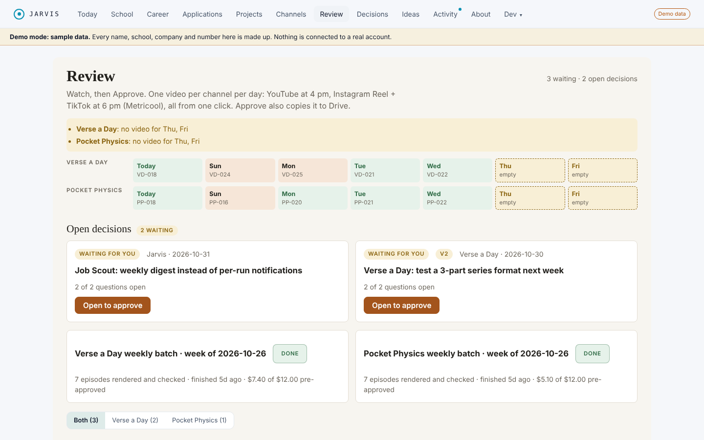
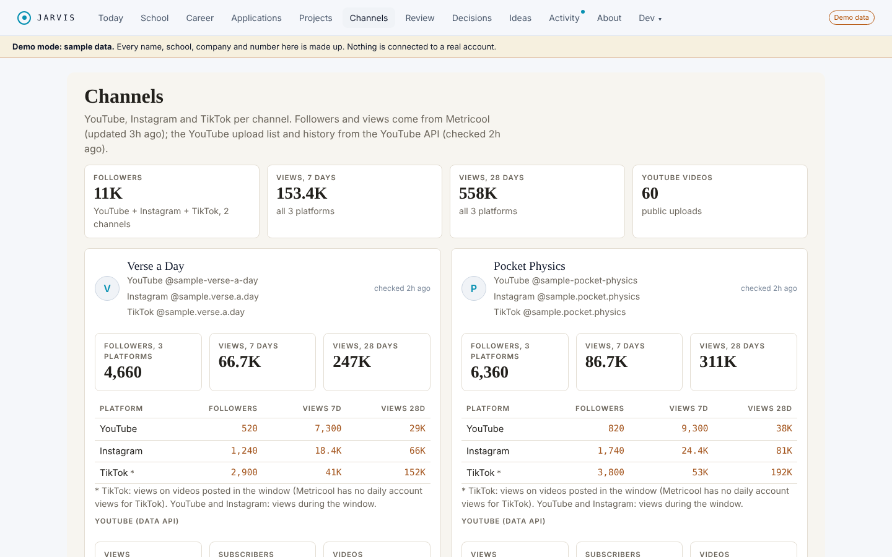
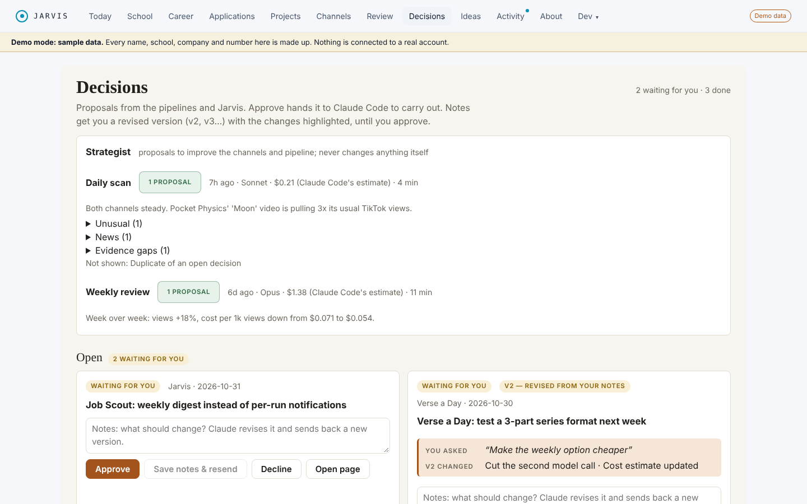
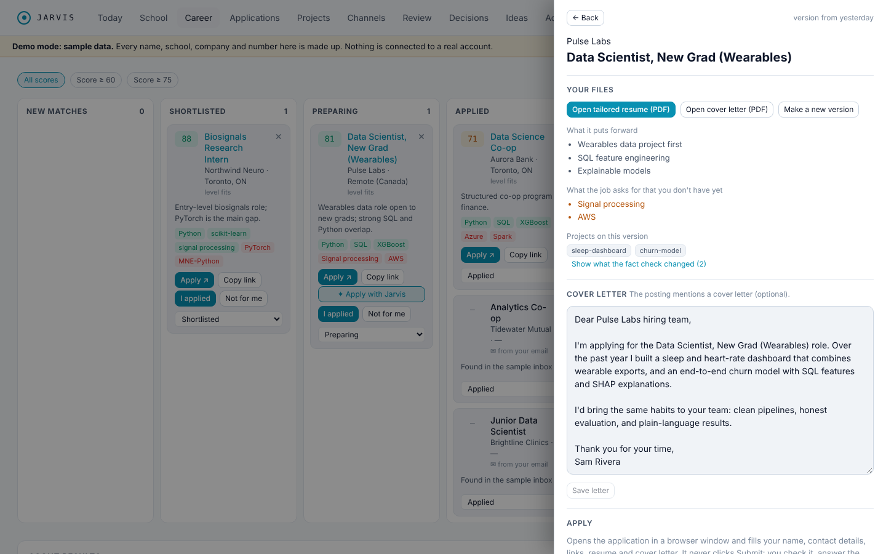
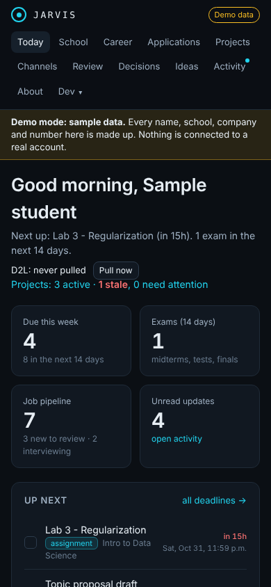
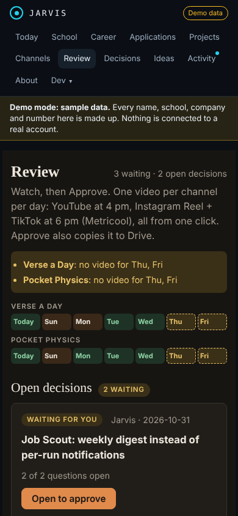

# Jarvis: sample dashboard

A live, static demo of **Jarvis**, a personal assistant made of small agents: school deadlines, a job search,
and the production pipeline for two short-video channels. Everything you see here is **made-up sample data**:
the people, schools, companies, channels, videos and numbers are fictional. Nothing is connected to a real account.

**Live demo:** https://tarduak-cs.github.io/jarvis-showcase/

## Screenshots

| Review: one approval queue for both channels | Channels: YouTube, Instagram and TikTok in one place |
| --- | --- |
|  |  |

| Decisions: proposals you approve or send back with notes | Apply with Jarvis: tailored resume, cover letter, form fill |
| --- | --- |
|  |  |

| Today (phone, dark) | Review (phone, dark) |
| --- | --- |
|  |  |

## What it does

- **School:** reads a course calendar feed, tracks deadlines and changes, and shows grading weights only when the
  course outline quotes them.
- **Career:** scores job postings against a profile, and runs a web search (Job Scout) that checks postings are
  still live where the site allows it.
- **Apply with Jarvis:** tailors a resume and cover letter for one job. Every bullet cites the profile facts it came
  from. A browser fills the form fields and never clicks Submit.
- **Email:** reads application-related mail over IMAP, read-only. Keeps only the verdict and header fields.
- **Review and Channels:** rendered videos wait in one queue with loudness, caption and cost checks plus a
  recommendation. One Approve schedules YouTube, Instagram and TikTok. Channels tracks followers, views and cost
  per episode.
- **Idea Lab:** Claude and GPT pitch video ideas and review each other's. The best are scripted, critiqued, revised
  and fact-checked before they reach the queue.
- **Strategist and Decisions:** a daily scan and a weekly review turn the numbers into proposals. Notes get a revised
  version; Approve hands it to Claude Code to carry out. The Strategist never changes anything itself.
- **AI Usage:** spend across Claude, GPT and the Claude Code CLI, by day and provider, against a monthly budget.

## Architecture

Agents write to one shared database. A FastAPI server exposes it to the dashboard, to desktop and phone
notifications, and to a read-only MCP server for the Claude desktop app. A model router sends each task to a
Claude tier (fast, smart or deep), retries a bad reply once on the next tier, and logs the cost of every call.

## Tech stack

Python, FastAPI, SQLAlchemy (SQLite, or Postgres), Typer, the Anthropic and OpenAI SDKs, Playwright, the YouTube
Data API, React 18, TypeScript and Vite.

## Safety rules

- Nothing is submitted, sent or posted without approval. The application filler never clicks Submit.
- Mailboxes are read-only, and email bodies are never stored.
- Facts about a person come only from their own profile file, never invented.
- Grading weights are never guessed.

The source repository is private. This page is a static copy with sample data only.
