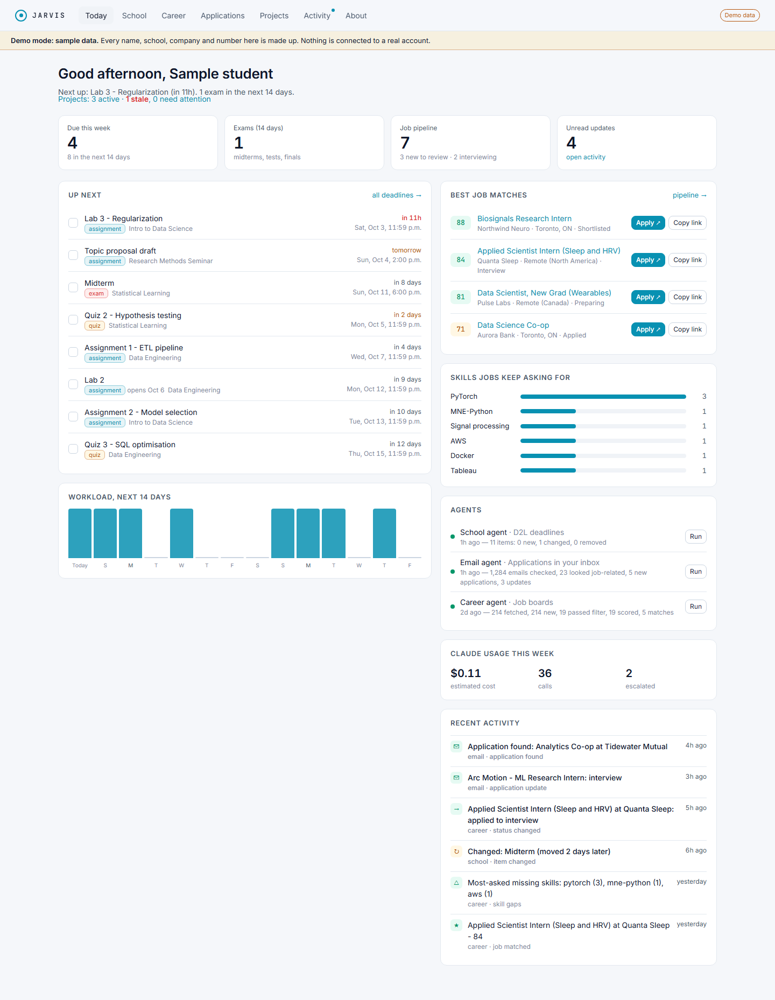
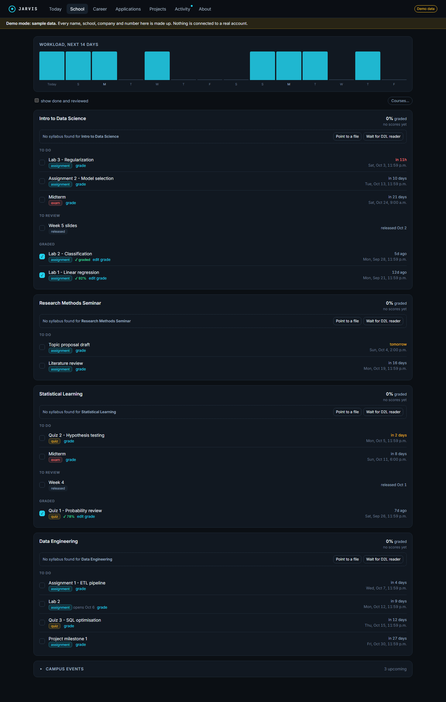
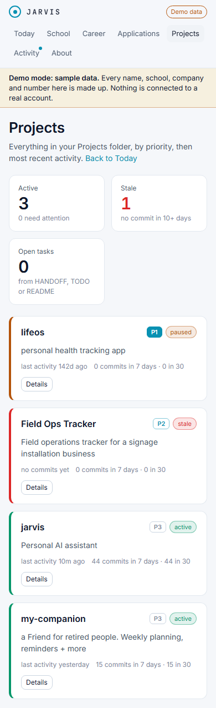
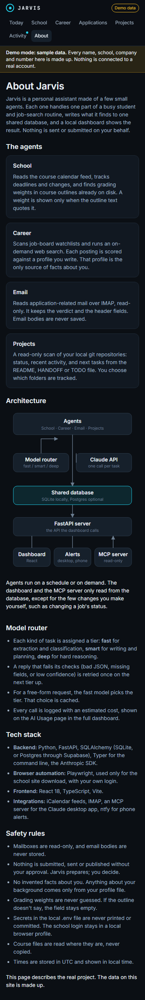

# Jarvis: sample dashboard

A live, static demo of **Jarvis**, a personal assistant made of a few small agents. Everything you see
here is **made-up sample data**: the names, schools, companies, grades and numbers are fictional. Nothing is
connected to a real account.

**Live demo:** https://tarduak-cs.github.io/jarvis-showcase/

## Screenshots

| Today (desktop, light) | School (desktop, dark) |
| --- | --- |
|  |  |

| Projects (phone, light) | About (phone, dark) |
| --- | --- |
|  |  |

## What it does

- **School:** reads a course calendar feed, tracks deadlines and changes, and shows what is due this week.
- **Career:** scores job postings against a profile, and runs a web search for new roles on demand.
- **Email:** reads application-related mail over IMAP, read-only. Keeps only the verdict and header fields.
- **Projects:** a read-only view of local git repositories: status, activity, and languages.

## Architecture

Agents write to one shared database. A FastAPI server exposes it to the dashboard, to desktop and phone
notifications, and to a read-only MCP server for the Claude desktop app. A model router sends each task to
a Claude tier (fast, smart or deep), retries a bad reply once on the next tier, and logs the cost of every call.

## Tech stack

Python, FastAPI, SQLAlchemy (SQLite, or Postgres), Typer, the Anthropic SDK, Playwright, React 18,
TypeScript and Vite.

## Safety rules

- Mailboxes are read-only, and email bodies are never stored.
- Nothing is submitted or sent without approval.
- Facts about a person come only from their own profile file, never invented.
- Grading weights are never guessed.

The source repository is private. This page is a static copy with sample data only.
